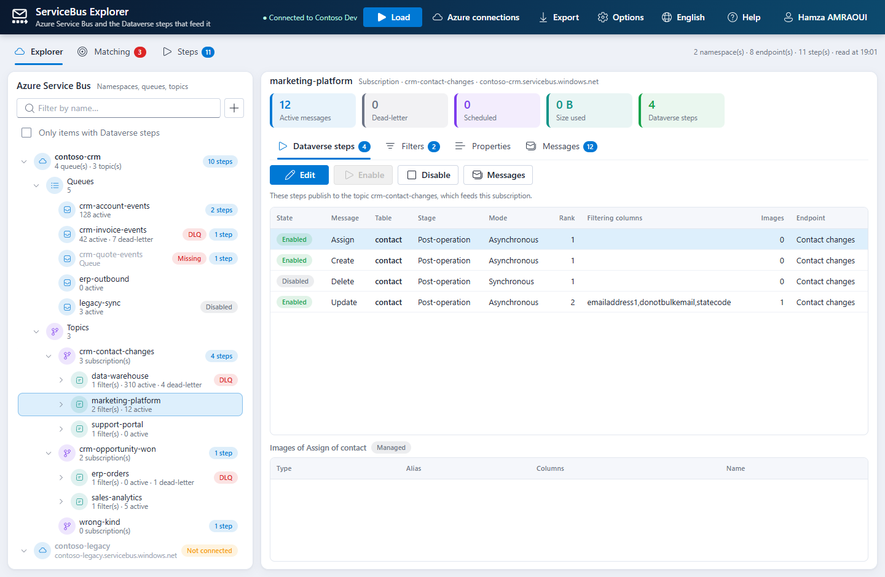
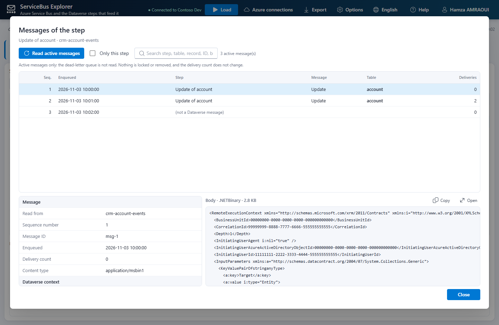
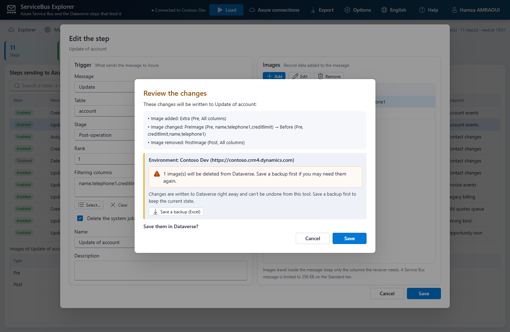

# ServiceBus Explorer for Dataverse (Power Platform ToolBox)

ServiceBus Explorer for [Power Platform ToolBox](https://www.powerplatformtoolbox.com/) is the web version of the ServiceBus Explorer XrmToolBox plugin. It shows your **Azure Service Bus** namespaces next to the **Dynamics 365 / Dataverse steps** that send messages to them:

- Which steps publish to this queue or this topic?
- Does every service endpoint still point to something that exists on Azure?
- What is filtered by this subscription, and how many messages are waiting?
- How do I change the trigger or the images of a step without the Plugin Registration Tool?
- Which active messages did this step send that are still waiting in the queue?

| Page | What it does |
|---|---|
| **Explorer** | Tree of the namespaces with their queues, topics, subscriptions and rules, the message counters and a dead-letter marker. For the selected item: the **Dataverse steps** that send to it, its **subscriptions and filters** (SQL and correlation filters, rule actions), its **properties**, and its **messages**. A subscription shows the steps of its topic, because they feed it. |
| **Matching** | Every service endpoint and every Azure entity with a status: *Linked*, *No steps*, *Missing on Azure*, *Wrong type*, *Not connected*, *No endpoint*. Paths are compared without case, like Service Bus does. Double-click a line to open it in the explorer. |
| **Steps** | Every step bound to a service endpoint, with search, the step editor (trigger and images, every change reviewed before it is written), bulk **enable / disable**, and **Messages**. |
| **Messages** | Peek of the **active messages** of a queue, topic or subscription, or of one step, each linked to the **step that sent it** (the `OwningExtension` of its Dataverse context) whatever the format of the endpoint: JSON, XML or .NETBinary. The dead-letter queue is not read. Nothing is locked or removed, and the delivery count does not change. |
| **Export** | One `.xlsx` workbook with the matching, the steps, the images, the entities, the subscriptions and the filters, saved through the ToolBox. |

The tool **only reads Azure**: it never changes a queue, a topic, a filter or a message. It only writes steps and step images in Dataverse, and only after a confirmation (see [What this tool changes](#what-this-tool-changes)). Nothing is read until you click **Load**.

## Screenshots

Demo data from the end-to-end tests.







## What this tool changes

**In Dataverse**, and only after you confirm a dialog that names the target environment (connection name and URL):

| Record | What is written |
|---|---|
| Step (`sdkmessageprocessingstep`) | Trigger (message and table), stage, mode, rank, filtering columns, name, description, "delete the system job on success". Only the values you changed are sent. |
| Step image (`sdkmessageprocessingstepimage`) | Images **created**, **updated** (type, alias, name, columns) and **deleted**. A removed image is deleted from Dataverse. |
| Step state | **Enable** and **disable**, one step or many. |

- **No undo.** Changes are written right away and can't be undone from the tool. Both confirmations (step editor review, bulk enable / disable) have a **Save a backup (Excel)** button: it saves the steps that will change and their images as they are now, with their ids, so you can put them back by hand. The **Export** button saves the full report at any time.
- **Managed steps**: a step from a managed solution that is customizable can be changed, and the change creates an **unmanaged layer** above it. A managed step that is not customizable is read-only.
- **Nothing else** is written: no service endpoint, no plug-in assembly, no solution.

**In Azure, nothing.** Namespaces, queues, topics, subscriptions and rules are only read. Messages are only peeked: nothing is locked, received or removed, and the delivery count does not change.

## How it differs from Plugin Registration

Plugin Registration registers and edits SDK message processing steps and service endpoints from the Dataverse side. It does not look at Azure. This tool is about the Azure side of those endpoints:

- **Azure namespace exploration**: queues, topics, subscriptions, SQL and correlation filters, rule actions, message counters, with the Dataverse steps that send to each of them.
- **Endpoint ↔ entity matching**: every service endpoint checked against what exists on Azure (*Linked*, *Missing on Azure*, *Wrong type*, *No steps*, *No endpoint*…).
- **Message peek linked to the sending step**: the active messages of a queue, topic or subscription, decoded (JSON, XML, .NETBinary) and linked to the step that sent them.

The step editor is deliberately small. It fixes a step from the place where you find the problem (a filter that never matches, an image too large for the queue). For full registration work (assemblies, plug-ins, new endpoints), use Plugin Registration.

## Project structure

The project follows the React + Vite template generated by `yo pptb` ([tool development docs](https://docs.powerplatformtoolbox.com/tool-development)), the same layout as MergeIt-PPTB.

```
ServiceBus Explorer - PPTB/
├── package.json                 Tool manifest: displayName, icon, features, cspExceptions (Azure hosts)…
├── index.html                   Vite entry point (main = index.html in dist)
├── vite.config.ts               IIFE bundle + HTML fix-up for the ToolBox iframe
├── public/icon/                 Tool icon: vector SVG in currentColor, follows the light and dark themes (copied to dist/icon)
├── src/
│   ├── App.tsx                  UI orchestration: load, tree, pages, steps, messages, export, busy overlay with Stop
│   ├── index.css, theme.ts      Azure blue theme, follows the ToolBox light/dark theme
│   ├── components/              Header, Tree, ExplorerDetail, StepsTable, MessagesPanel, Pages (Matching, Steps),
│   │                            StepEditor (+ image editor, column picker), ConnectionsDialog, Dialogs, Common
│   ├── hooks/useToolbox.ts      Settings (toolboxAPI.settings), theme, connection, events
│   ├── i18n/                    All UI text, in English and French
│   ├── models/types.ts          Endpoints, steps, images, namespaces, entities, rules, messages, settings
│   └── services/
│       ├── endpointService.ts   Service endpoints, steps, images, messages, filters, columns; writes (Web API)
│       ├── stepRules.ts         Registration rules and the review lines of a change
│       ├── matching.ts          Dataverse ↔ Azure matching, ghosts
│       ├── azure/               Connection strings and SAS (WebCrypto), Atom and ARM readers, Entra tokens,
│       │                        AMQP peek (Azure SDK over WebSockets)
│       ├── messageDecoder.ts    JSON / XML / .NETBinary bodies → Dataverse context
│       ├── nbfx.ts              Decoder of the .NET Binary XML format (MC-NBFX)
│       ├── messageService.ts    Reads the messages of the queues and subscriptions, links them to the steps
│       └── exportService.ts     Excel workbook (fflate)
└── tests/
    ├── logic/run.mts            Parsers, SAS vector, matching, rules, decoders, export, message reading
    ├── emulator/run.mts         The real AMQP path against the Service Bus emulator (docker)
    ├── e2e/                     Headless browser against an in-memory Dataverse and ToolBox
    └── fixtures/                RemoteExecutionContext serialized by the .NET SDK (JSON, XML, .NETBinary)
```

### Mapping from the XrmToolBox plugin

| XrmToolBox (C# / SDK) | Power Platform ToolBox (TypeScript / Web API) |
|---|---|
| `RetrieveMultiple` (QueryExpression, paging) | `dataverseAPI.queryData` with FetchXML and a paging cookie |
| `RetrieveEntityRequest` (columns) | `EntityDefinitions(LogicalName='…')/Attributes` |
| `Update`, `Create`, `Delete` | `dataverseAPI.update`, `create`, `delete` (lookups with `@odata.bind`) |
| `HttpClient` to the Atom management endpoint and Azure Resource Manager | `fetch`, allowed by the `cspExceptions` of `package.json` |
| SAS token (`HMACSHA256`) | WebCrypto `HMAC SHA-256` (same output, checked against the same vector) |
| Browser sign-in with a loopback redirect | Device code sign-in (the ToolBox gives tools no redirect and no token) |
| `az account get-access-token` started as a process | the same command through `toolboxAPI.terminal` (hidden terminal) |
| `Microsoft.Azure.Amqp` (merged in the DLL) | `@azure/service-bus` (AMQP over WebSockets, port 443) |
| `XmlDictionaryReader.CreateBinaryReader` | `src/services/nbfx.ts` (tested against the rendering of .NET) |
| `ExcelWriter`, `SaveFileDialog` | `fflate` + `toolboxAPI.fileSystem.saveFile` |
| `SettingsManager`, DPAPI | `toolboxAPI.settings` (see the note on connection strings below) |

## Azure access

The first time, the ToolBox asks you to allow the network access the tool declares in `cspExceptions`: `https://*.servicebus.windows.net`, `wss://*.servicebus.windows.net`, `https://management.azure.com` and `https://login.microsoftonline.com`. Accept it, otherwise every Azure call fails with a "cannot be reached" message.

| Method | Needs | Notes |
|---|---|---|
| **Connection string** | A namespace-level key with the **Manage** right | Kept in memory for the session. Tick **Remember it on this computer** to keep it: the ToolBox settings are **not encrypted** (the XrmToolBox version uses DPAPI, which a web tool cannot). |
| **Microsoft account** (code) | The **Reader** role on the namespace | Device code: open the sign-in page, enter the code shown by the tool. Tokens stay in memory. |
| **Azure CLI** | `az login`, and the **Reader** role | Runs `az account get-access-token` in a hidden ToolBox terminal. |

Reading the **messages** needs a little more: the **Listen** right for a key (Manage includes it), or the **Azure Service Bus Data Receiver** role for a Microsoft account (Reader and Owner are not enough).

## Build

Requirements: Node.js 18 or later.

```bash
npm install
npm run build        # type-check + vite build -> dist/
npm run dev-watch    # development build with source maps, rebuilt on save
npm run validate     # pptb-validate: checks package.json against the ToolBox rules
```

## Automated tests

```bash
npm run test:logic      # parsers, SAS, matching, rules, decoders (against the .NET fixtures), export
npm run test:e2e        # headless Edge / Chrome against the in-memory Dataverse and ToolBox
npm run test:emulator   # the real AMQP peek against the Service Bus emulator
```

- **Logic**: the same checks as the C# tests, plus the three Dataverse formats produced by the .NET SDK (`tests/fixtures`). The binary decoder is compared element by element with the rendering of .NET itself.
- **End-to-end** (`tests/e2e/run.cjs`): builds the tool, serves it and drives the browser. Dataverse and the ToolBox are mocked in `tests/e2e/mockHost.js`; the Atom feeds and Azure Resource Manager are answered by the test, which checks the SAS signature and the bearer token of every call. Any extra Dataverse header fails the test, because the ToolBox would show a consent prompt for it. The messages come from a test hook (`__SBX_E2E__`), because the browser cannot open AMQP WebSockets to a mock; one test runs the real SDK in the bundle and checks it opens `wss://<namespace>/$servicebus/websocket`. Set `SBX_SHOTS=<folder>` to save screenshots, `PW_BROWSER` if your browser is not in a standard location.
- **Emulator** (`tests/emulator/run.mts`): sends messages the way Dataverse does, abandons one, then peeks twice with the tool code (Node uses AMQP over TCP, the ToolBox uses WebSockets). It expects the [Service Bus emulator](https://github.com/Azure/azure-service-bus-emulator-installer) on `localhost` with the queue `dataverse-queue` and the topic `dataverse-topic` (subscriptions `all` and `accounts`, the latter filtered on `[http://schemas.microsoft.com/xrm/2011/Claims/EntityLogicalName] = 'account'`).

## Test in Power Platform ToolBox

1. Run `npm run build`.
2. In Power Platform ToolBox, open **Settings**, turn on **Show Debug Menu**, and select **Save**.
3. In the **Debug** section, under **Load Local Tool**, select **Browse**, pick this folder (the one that contains `package.json`), then select **Load Tool**.
4. Open **ServiceBus Explorer** and pick a connection. The tool declares one required Dataverse connection (`features.connections = 1`). Accept the network access it asks for.
5. After you rebuild, close the tool tab and open it again.

## Publish

1. Update `version` in `package.json` (or run `npm version patch`).
2. Run `npm run build`, `npm run validate`, then `npm run finalize-package` (`npm shrinkwrap`).
3. Run `npm publish --access public`.
4. Submit the package at https://www.powerplatformtoolbox.com/submit-tool.

## Known limitations

- **Microsoft sign-in**: the ToolBox gives tools no Azure token, so the tool signs in with a device code. Some tenants block the device code flow by Conditional Access; use the Azure CLI or a connection string there.
- **Connection strings** are not encrypted when you ask the tool to remember them (ToolBox settings). Leave **Remember** unticked to keep them in memory only.
- **Messages**: only the active messages are read, never the dead-letter queue. A message already taken by a consumer is no longer visible. Session-enabled queues are not supported by the peek.
- **Emulator**: the Service Bus emulator does not accept WebSockets: its messages can only be read by the Node tests, not from the ToolBox.
- **Binary bodies**: a .NETBinary body written with a dictionary shows its dictionary strings as `dict_N` (Dataverse writes without one).

## AI Assistance

A substantial part of the code, the tests and this documentation was written with an AI coding assistant (Claude Code, by Anthropic).
Manual tests are already done by the author, don't hesitate to share your feedback.

## Credits

Port of the [ServiceBus Explorer XrmToolBox plugin](https://github.com/AmraouiH/ServiceBusExplorer) by Hamza AMRAOUI.

## Support

If the tool helps you, you can support its development on [PayPal](https://www.paypal.com/paypalme/EntityFieldsAnalyser). Bugs and ideas: [GitHub issues](https://github.com/AmraouiH/ServiceBusExplorer-PPTB/issues).

## License

MIT
